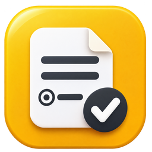

# YaFormCreator — универсальный конструктор Яндекс Форм

Настольное приложение для Windows: визуальное создание и редактирование JSON-конфигураций анкет, проверка структуры и создание **новых** Яндекс Форм через API.

**[Открыть сайт](https://teenkode.github.io/ya-form-creator/)** · **[Скачать расширение](https://teenkode.github.io/ya-form-creator/yaform-extension.zip)** · **[Установка, вход и приватность](docs/WEB_EXTENSION_RU.md)**.

Веб-приложение работает без сервера: подготовка и предпросмотр локально, отправка в Яндекс через расширение после отдельного подтверждения. Каждый пользователь подключает свой аккаунт и организацию; токен остаётся в расширении. Расширение устанавливается распакованным в режиме разработчика, публикации в магазинах пока нет.

С версии 1.6 сайт и расширение подключаются только к **Identity Hub**: войдите через Яндекс, выберите или создайте организацию в открытом кабинете, затем подтвердите подключение. Получать IAM-токен не нужно. Если ID не удалось определить автоматически, его можно скопировать под названием организации. [Пошаговая помощь на сайте](https://teenkode.github.io/ya-form-creator/help.html#token). Настольная версия сохраняет поддержку прежних подключений.

С версии 1.5 есть [мастер создания Identity Hub](https://teenkode.github.io/ya-form-creator/help.html#create-cloud): он открывает Cloud Center, где пользователь подтверждает создание, затем помогает найти организацию и подставить ID. Публичного Create API для организации нет; мастер не создаёт её без пользователя и не подключает платные ресурсы.



**Начните с [подробной инструкции](docs/SETUP_RU.md):** установка, первая анкета, создание организации 360 или Cloud, ID организации, OAuth/IAM-токен, публикация и решение ошибок. Эта же инструкция доступна внутри приложения по кнопке «Как начать», в том числе без интернета.

## Создать анкету с помощью любого ИИ

Если чат не читает GitHub, передайте [единый TXT с правилами](https://teenkode.github.io/ya-form-creator/ai-instructions.txt) или скопируйте его на сайте через **«Создать с ИИ»**. Затем отправьте своё задание. Несколько файлов и доступ к репозиторию не нужны. [Подробнее](docs/AI_OFFLINE_RU.md).

Отправьте агенту ссылку на этот репозиторий и своё описание анкеты. [START_HERE_AI.md](START_HERE_AI.md) содержит готовый запрос для копирования и порядок чтения; [AGENTS.md](AGENTS.md) — инструкции агенту. Если ИИ не умеет открывать ссылки, приложите эти файлы и [правила JSON](AI_JSON_RULES.md) к сообщению.

С версии **1.2.0** текстовые поля имеют явные форматы: ФИО, телефон РФ, почта, ссылка, ИНН и дробное число. [Справочник полей](docs/FIELD_GUIDE_RU.md) объясняет, почему номера документов и заказов — текст, как сохранять ведущие нули и когда нужно уточнить запрос. Для агентов есть [JSON Schema](schema/form.schema.json) и проверка `python check_agent_form.py --config FILE.json`. [Сценарии проверки и ограничения](docs/AGENT_CHECKS_RU.md).

**Для специальных форматов нужен EXE 1.2.0 или новее:** версии до 1.2.0 игнорируют format. Наличие правил не гарантирует их соблюдение любой моделью: проверяйте полученный файл и соответствие исходному заданию.

В интерфейсе есть пошаговые ориентиры, понятные названия типов ответа, карточка вопроса, визуальная настройка условий показа и кнопки для открытия и копирования ссылок. JSON-редактор находится в меню «Дополнительно». Пустую анкету можно сохранить как заготовку.

Результаты ревью и границы проверки: [docs/REVIEW_RU.md](docs/REVIEW_RU.md).

**В репозитории и EXE нет готовых анкет, форм или демонстрационных JSON.** При запуске открывается пустой конструктор. Готовую анкету можно создать вручную, сформировать по [правилам для ИИ](AI_JSON_RULES.md) или открыть локальный JSON через «Открыть JSON».

## Скачать EXE

В [Releases](https://github.com/TeenKode/ya-form-creator/releases) опубликованные версии содержат один автономный файл `YaFormCreator.exe`, собранный PyInstaller на Windows (Python при запуске не требуется).

Скопируйте EXE в **папку с правом записи**. Все персональные файлы будут находиться рядом с ним:

- `user_settings.json` — размер окна и путь к последней открытой анкете;
- `.yandex_form_credentials.json` — токен и ID организации, **только если явно согласились сохранить**;
- ваши анкеты `*.json` — создаются при нажатии «Сохранить» / «Сохранить как» и никогда не вшиваются в EXE.

**Безопасность:** токен записывается без шифрования. Не храните его в общей папке и не отправляйте вместе с EXE. Для сброса авторизации удалите `.yandex_form_credentials.json` при закрытой программе. Настройки не сохраняются в AppData.

Также можно удалить сохранённый токен через меню «Дополнительно». Переменные окружения имеют приоритет перед файлом; удаление файла их не сбрасывает. IAM поддерживается только с организацией Cloud. Автоматическое переключение типа организации не выполняется.

## Предпросмотр анкеты

«Предпросмотр» открывает локальную интерактивную имитацию анкеты **без обращения к API и без передачи ответов**:

- `radio` — переключатели: **ровно один** вариант;
- `checkbox` — флажки: **несколько** независимых вариантов;
- `dropdown` — выпадающий список; `scale`, `stars`, `onerow` — выбор в одну строку;
- `text`, `integer`, `date`, `boolean`, `matrix` — подходящие поля ввода;
- «Другое» и условия показа отображаются в зависимости от выбранных ответов;
- «Проверить ответы» находит незаполненные обязательные поля, неверные даты, число вне диапазона, нарушения ограничений выбора и длины текста;
- «Очистить» сбрасывает всё введённое. Длинные анкеты можно прокручивать.

Это **предварительная имитация**, а не точная копия интерфейса Яндекса. Окончательная проверка условий, внешнего вида и API-специфичных типов выполняется в Яндекс Формах после создания черновика.

Клавиши: `Ctrl+N` новая анкета, `Ctrl+O` открыть, `Ctrl+S` сохранить, `Ctrl+Shift+S` сохранить как, `F5` предпросмотр, `F6` проверка логики. `Delete` удаляет выделенный элемент списка (с подтверждением).

## Логика взаимоисключающих ответов

Вопрос с несколькими ответами может содержать «Не использую», «Ничего не мешает», «Нет необходимости» и подобные исключающие варианты.
YaFormCreator распознаёт распространённые формулировки автоматически. В редакторе вопроса можно указать исключающие ответы вручную либо добавить в JSON вопроса поле `exclusive_options` (массив точных названий вариантов); `[]` отключает автоопределение.

**Защита действует в самой созданной Яндекс Форме.** Генератор создаёт промежуточный вопрос с одним выбором: «Выбрать варианты из списка» или один из исключающих ответов. Список галочек доступен только в первом случае; исключающие ответы не присутствуют среди галочек. В предпросмотре используется такая же логика. Для работы нужны минимум два обычных варианта после исключения.

## Проверка логики между вопросами (с v1.1.0)

Откройте **«Проверка логики…»** или нажмите **F6**. Программа находит вероятные зависимости между вопросами: например, если участник ответил «Не использую ИИ», ему может быть неуместно отвечать, *какие инструменты ИИ он использует*.

- Отображает предыдущий ответ, возможное противоречие и предлагаемое условие показа.
- **«Применить выбранное»** и **«Применить все предложения»** добавляют проверенные условия в JSON по подтверждению пользователя.
- Существующие сложные условия не перезаписываются: вместо этого показывается предупреждение «Проверить вручную».
- При обычной проверке структуры и непосредственно перед созданием формы программа предупредит о найденных логических проблемах.
- Предпросмотр отображает новые условия; старые анкеты продолжают открываться без изменения формата.

Анализ выполняется **локально** и не передаёт вопросы ИИ-сервисам. Это объяснимые правила и эвристики, а не безошибочное понимание текста: непрямые связи и сложные смысловые противоречия могут остаться незамеченными. Программа не изменяет JSON автоматически без подтверждения.

Взаимоисключающие ответы **внутри одного вопроса** обрабатываются отдельно; условия показа **между разными вопросами** можно добавлять через анализатор или вручную.

## Создание JSON по описанию

Передайте ИИ документ или описание анкеты и файл [AI_JSON_RULES.md](AI_JSON_RULES.md). Попросите вернуть **только валидный UTF-8 JSON**, соответствующий правилам. Сохраните его под произвольным именем `.json`, откройте в конструкторе и нажмите «Проверить» / «Предпросмотр», затем «Создать в Яндексе».

## Разработка

На Windows с Python 3.12:

```powershell
py -3 -m pip install -r requirements.txt
py -3 app.py
py -3 create_yandex_form.py --config "C:\path\to\my-form.json" --validate
py -3 create_yandex_form.py --config "C:\path\to\my-form.json" --dry-run
py -3 -m unittest discover -v -p "test*.py"
```

`--dry-run` не отправляет запросы в API. Создание формы создаёт **новый** объект; существующую форму программа не изменяет. По умолчанию публикация выключена.

## Сборка и релизы

```powershell
py -3 -m pip install -r requirements-build.txt
py -3 -m unittest discover -v -p "test*.py"
pyinstaller --noconfirm --clean yaformcreator.spec
```

Результат: `dist/YaFormCreator.exe` (one-file). [.github/workflows/build-release.yml](.github/workflows/build-release.yml) тестирует и собирает EXE на Windows в каждом PR и push `main`; EXE сохраняется в Actions → Artifacts. Версионные теги `v*` публикуют EXE в GitHub Releases. Файл `VERSION` задаёт следующую версию: при первом успешном запуске сборки новой версии из `main` GitHub Actions создаёт тег и релиз; повторные коммиты не дублируют опубликованную версию.

Подготовка публикации в Opera Add-ons: [пакет и порядок отправки](docs/opera-store/SUBMIT_RU.md). Расширение ещё не опубликовано в магазине. [Конфиденциальность](https://teenkode.github.io/ya-form-creator/privacy.html).
